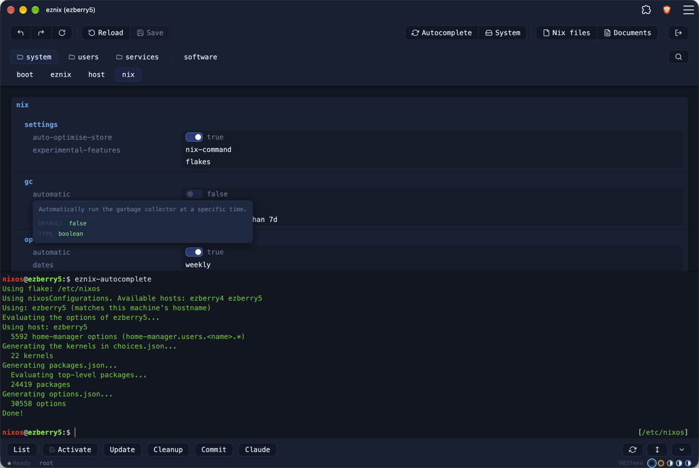
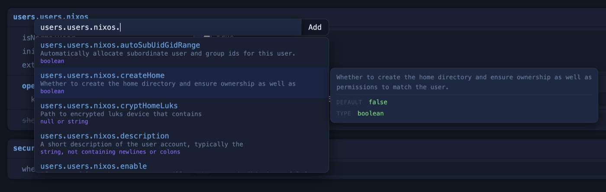
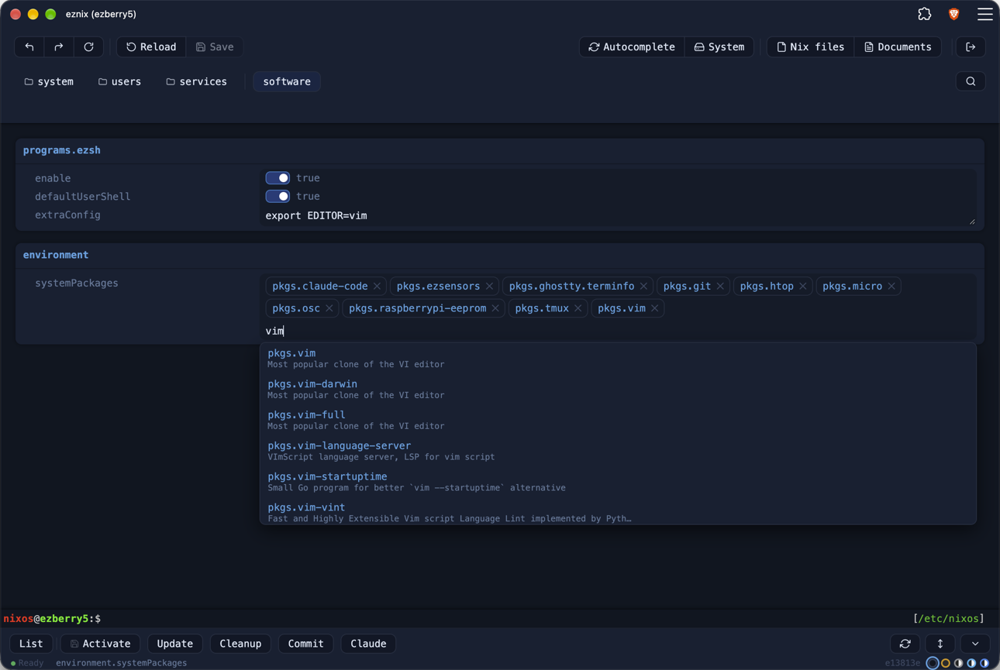
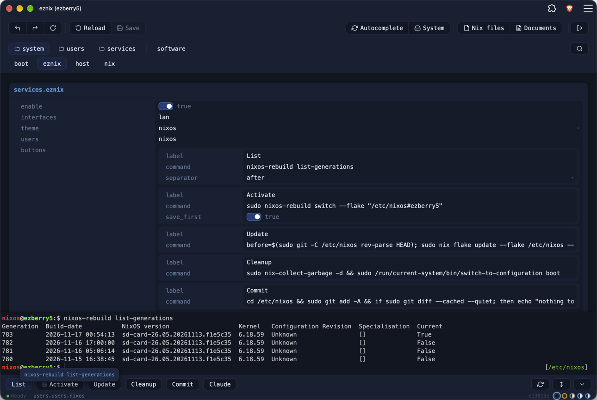
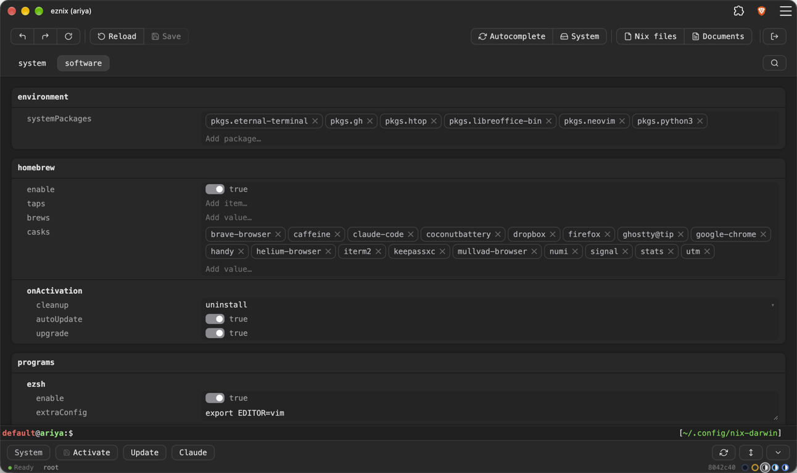
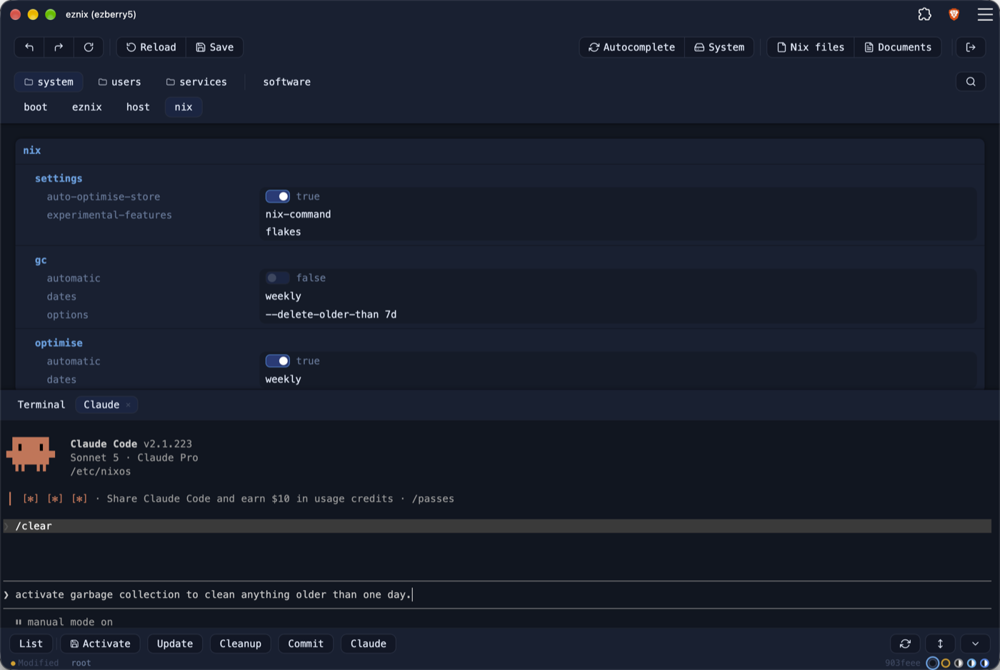

Nix has a steep learning curve. The language, the thousands of options and the way a system is put together all take time to learn, and many people give up before they see what makes it good. This is an attempt to make Nix easier and more approachable.

[eznix](https://github.com/kalken/eznix) lets you change the settings of a Nix system in your browser instead of editing files by hand. Open the page, find the option you want, change it and press Activate: a real terminal beside the editor does the rebuild. It is the successor to my earlier project, ezconf, and it works on NixOS, on a Mac with nix-darwin and on other Linux with home-manager. It is a simple and small program, made to run on anything from powerful workstations and servers to single board computers.

## What you work with

The editor shows your configuration as tabs, one for each file, with sections you can fold, switches for booleans, lists of items and chips for packages. Settings are saved as small JSON files in a folder inside your flake, and one line in your configuration pulls them in; your own `.nix` files keep working beside them.

You can move between Nix and JSON whenever you want. In the editor, right-click a section or option to convert it to a Nix expression, and back again. Copy puts it on the clipboard as text to paste into Import on another computer, and Copy as Nix puts it there as Nix. Import also reads Nix, so you can paste in a whole `configuration.nix` and it becomes JSON.



*The `nix` tab of a NixOS machine. Hovering an option shows its documentation, default and type, and below the editor Autocomplete is generating the suggestions in the terminal.*

## Suggestions from your own flake

Nix systems have thousands of options, many with dynamic keys like `users.users.<name>.packages`. The **Autocomplete** button runs `eznix-autocomplete`, which asks Nix about *your* flake and writes down every option and package it can set. The suggestions match exactly what your configuration can do, not some other version of Nix or its modules, and they include the options of nix-darwin, home-manager, and the kernels and Homebrew packages where they apply.

It is only run when you press the button, so nothing evaluates behind your back, and you can follow it in the terminal.



*Adding an option: as you type a path, eznix lists the options that match, each with its type and description, and the one under the pointer is explained on the right.*

When you type a path with a placeholder in it, the editor knows where it is: `users.users.` suggests the users you already have. Where an option takes a fixed set of values, you get a dropdown. Where a value is a Nix expression, it is completed by name as in a text editor: `pkgs.` and `config.` names, and the options under the one you are editing.

An existing `configuration.nix` can be imported into the editor. It is a data-oriented parser, not a full Nix evaluator: anything that is not plain data is kept as a Nix expression.

Packages are a list you add to by typing, each one a chip you can remove:



*Adding a package: typing `vim` lists the matching packages with their descriptions. Added packages are chips in the list.*

## Nothing is written until you save

The editor is built to be hard to break things with:

- Nothing touches the disk until you press Save, including deletes, renames and moves.
- Undo and redo go back through every change, and the earlier versions of each file are kept.
- If a file changes on disk while the page is open (a `git pull`, or the terminal), it shows up in the page by itself. A file with unsaved changes keeps them and is marked, and Save never writes over a change you haven't seen.
- Ctrl+F searches all files at once: type words from an option, a value or a file name, in any order.
- Settings can be disabled without deleting them.

## A terminal and buttons you define

Rebuilding happens in a real terminal in the page. The buttons above it type commands into it, and they are not hardcoded. They are defined in the configuration itself, under `services.eznix.buttons`, like any other service setting, so they are tracked in git with everything else.



*The settings of eznix itself. Each entry under `buttons` is one button in the bar at the bottom, with a label and the command it types into the terminal.*

Nothing in eznix runs as root. A rebuild goes through `sudo` in that terminal, which asks for your password like it would anywhere else.

## Configured like any other service

eznix is a NixOS module, a nix-darwin module and a home-manager module. First add it to your flake, as an input and in the modules of your system:

```nix
inputs.eznix.url = "github:kalken/eznix";

# in the modules of your system:
modules = [
  ./configuration.nix
  eznix.nixosModules.default      # darwinModules.default on macOS, homeModules.default for home-manager
  (eznix.lib.jsonDir ./eznix)     # the settings eznix saves, as part of your configuration
];
```

Then turn it on like any other service, in a few lines:

```nix
services.eznix = {
  enable = true;
  users  = [ "alice" ];   # your user name
};
```

HTTPS is on when the page is reached from other computers, with a certificate eznix makes for itself. Login is with your system password, or one of its own. It can also put an entry in the application menu that opens it.

## Keep the system declarative

My advice is to keep the system declarative and not mix it with your personal settings. The system is what eznix edits: services, users, packages, boot, network. Your personal settings, the dotfiles and preferences in your home folder, are treated like on any other system: keep them in git, or just back up the home folder. I don't use home-manager for them. That keeps the configuration small, easy to read in an editor like eznix, and the same on every machine, while your own files stay yours.

## Architecture

**A Python server** (`eznix.py`, one file, standard library only) serves the page, the API, logins and the terminal's connection.

**A terminal program** (`eznix-terminal.py`) runs as a separate process for each user and connects a WebSocket to a PTY. The browser never talks to it directly; the server checks the login first.

**A vanilla JS page** with one script and no modules is the whole editor.

**Plugins** add things that need nothing from the system: reading the flake's Markdown files beside the editor, backing up and importing a whole system, opening other files in your own editor, uploading files. Nine ship with it, and you can write your own.

## Themes

Themes are plain CSS files that only set variables. NixOS blue and gruvbox are built in, as are OS X, KDE Breeze and GNOME, each light or dark with the system. You can write your own.



*The same editor on a Mac with nix-darwin, in the OS X theme: system packages, Homebrew casks and program settings.*

## Try it

Without installing anything:

```bash
nix run --no-write-lock-file github:kalken/eznix -- --flake /path/to/your/flake --password something
```

Then open http://localhost:9090 and log in with that password. The [README](https://github.com/kalken/eznix#-quick-start) has lines to copy for installing it on NixOS, a Mac and other Linux.

## A starting point

eznix is one take on what graphical configuration of a Nix system can look like. The idea underneath is simple: modules expose structured, documented options, and JSON maps cleanly onto that structure. Everything else is user interface.

If you have ideas for how it could be better, I'd love to hear them.

## Oh, I almost forgot

Because eznix has a fully functional terminal, nothing stops you from talking to the AI overlords to sort things out for you. Start an AI tool in the terminal, tell it what you want changed, and it works on the same configuration files you see in the editor, which then show up in the page by themselves. A button can start it for you, like the Claude button in the screenshots. You still look at the changes and press Activate yourself... if you want to...

If you are even more lazy, you can of course install something like [Handy](https://github.com/cjpais/Handy) to fill the terminal with the sound of your voice, and have the agent rebuild the system for you too 🍺.



*Claude Code started from the Claude button, in a tab of its own beside the editor. The prompt asks it to turn on garbage collection for anything older than a day.*
